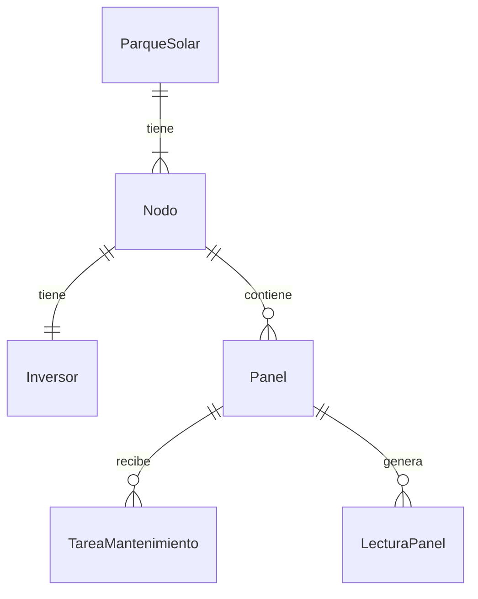

# Modelo de datos de SolarUY (MER)

Este documento describe las entidades del dominio de SolarUY, sus atributos y sus relaciones. Es la transcripción en texto del diagrama `MER_SolarUY.drawio` (notación pata de gallo).

Es una propuesta inicial: los atributos y los tipos se ajustan en cada requerimiento (`specs.md`).

## Instrucciones para el agente

1. Este documento es la referencia del modelo de dominio. Usa exactamente estos nombres de entidades y atributos (en español, `PascalCase`).
2. No agregues entidades, atributos ni relaciones que no estén aquí sin autorización del equipo. Si un requerimiento necesita algo que falta, documenta la duda en `specs.md` y crea una tarea de clarificación en `tasks.md`, sin inventar una solución.
3. Implementa solo las entidades que el requerimiento actual necesita. No generes todo el modelo de una vez.
4. Todas las claves primarias son `Guid` generados por el Dominio en el constructor, igual que en `ParqueSolar`.
5. Las entidades siguen las reglas de `4_modelado_dominio.md` y las convenciones de `3_convenciones_nomenclatura.md`: constructor que valida, `private set`, comportamiento dentro de la entidad.
6. Las fechas y horas se guardan en UTC (`DateTime`).
7. Los tipos de la columna "Tipo sugerido" son una propuesta coherente con `ParqueSolar`. Si el requerimiento exige otro, justifícalo en `specs.md`.
8. Cada cambio de este modelo genera una migración de EF Core en `SolarUY.Infrastructure/Migrations`, con un nombre claro (por ejemplo `AddNodo`).

## Diagrama

## Relaciones

| Origen | Verbo | Destino | Cardinalidad | Clave foránea |
|---|---|---|---|---|
| `ParqueSolar` | tiene | `Nodo` | 1 a 1..N: un parque tiene uno o más nodos; un nodo pertenece a un solo parque | `Nodo.ParqueId` |
| `Nodo` | tiene | `Inversor` | 1 a 1: cada nodo tiene exactamente un inversor | `Inversor.NodoId` (única) |
| `Nodo` | contiene | `Panel` | 1 a 0..N: un nodo contiene cero o más paneles; un panel está instalado en un solo nodo | `Panel.NodoId` |
| `Panel` | recibe | `TareaMantenimiento` | 1 a 0..N: un panel recibe cero o más tareas de mantenimiento | `TareaMantenimiento.PanelId` |
| `Panel` | genera | `LecturaPanel` | 1 a 0..N: un panel genera cero o más lecturas | `LecturaPanel.PanelId` |

## Entidades

### ParqueSolar

Un parque solar con configuración independiente de los demás.

| Atributo | Tipo sugerido | Clave | Obligatorio | Notas |
|---|---|---|---|---|
| `Id` | `Guid` | PK | Sí | |
| `Nombre` | `string` | | Sí | Único. Máximo 100 caracteres. |
| `Ubicacion` | `string` | | Sí | Máximo 200 caracteres. |
| `CapacidadEstimadaMW` | `decimal?` | | No | Capacidad estimada en megavatios. |
| `FechaCreacion` | `DateTime` | | Sí | UTC. Se asigna al crear. |

Relaciones: tiene uno o más `Nodo`.

### Nodo

Un conjunto de paneles dentro de un parque, con su inversor.

| Atributo | Tipo sugerido | Clave | Obligatorio | Notas |
|---|---|---|---|---|
| `Id` | `Guid` | PK | Sí | |
| `ParqueId` | `Guid` | FK a `ParqueSolar` | Sí | |
| `Nombre` | `string` | | Sí | |
| `UbicacionEnParque` | `string` | | Sí | Ubicación del nodo dentro del parque. |
| `CantidadPanelesPrevista` | `int?` | | No | Cantidad prevista en la configuración. La cantidad real son las filas de `Panel` asociadas. |

Relaciones: pertenece a un `ParqueSolar`; tiene un `Inversor`; contiene cero o más `Panel`.

### Inversor

Equipo que convierte la corriente continua (CC) de los paneles en corriente alterna (CA) para la red. Cada nodo tiene exactamente uno.

| Atributo | Tipo sugerido | Clave | Obligatorio | Notas |
|---|---|---|---|---|
| `Id` | `Guid` | PK | Sí | |
| `NodoId` | `Guid` | FK a `Nodo` | Sí | Único: relación 1 a 1. |
| `Marca` | `string` | | Sí | |
| `Modelo` | `string` | | Sí | |
| `PotenciaNominalKW` | `decimal` | | Sí | En kilovatios. |
| `Estado` | `enum` (valores por definir) | | Sí | |
| `VolcadoRedActivo` | `bool` | | Sí | Indica si el nodo está volcando energía a la red. |

Relaciones: pertenece a un `Nodo`.

### Panel

Panel fotovoltaico instalado en un nodo.

| Atributo | Tipo sugerido | Clave | Obligatorio | Notas |
|---|---|---|---|---|
| `Id` | `Guid` | PK | Sí | |
| `NodoId` | `Guid` | FK a `Nodo` | Sí | |
| `NumeroSerie` | `string` | | Sí | Único. |
| `Marca` | `string` | | Sí | |
| `Modelo` | `string` | | Sí | |
| `PotenciaNominalW` | `decimal` | | Sí | En vatios. |
| `FechaInstalacion` | `DateTime` | | Sí | UTC. |
| `Estado` | `enum` | | Sí | Valores del diagrama: `Activo`, `Inactivo`, `Falla`. |

Relaciones: pertenece a un `Nodo`; recibe cero o más `TareaMantenimiento`; genera cero o más `LecturaPanel`.

### TareaMantenimiento

Tarea de mantenimiento sobre un panel, por ejemplo una limpieza, realizada por personal especializado.

| Atributo | Tipo sugerido | Clave | Obligatorio | Notas |
|---|---|---|---|---|
| `Id` | `Guid` | PK | Sí | |
| `PanelId` | `Guid` | FK a `Panel` | Sí | |
| `Tipo` | `string` o `enum` (por definir) | | Sí | Ejemplo del diagrama: limpieza. |
| `Descripcion` | `string` | | Sí | |
| `FechaProgramada` | `DateTime` | | Sí | UTC. |
| `FechaRealizacion` | `DateTime?` | | No | Se completa al realizar la tarea. |
| `Estado` | `enum` (valores por definir) | | Sí | |
| `ResponsableId` | `string` | | Sí | Id del usuario en Keycloak (claim `sub`). Sin clave foránea. |

Relaciones: pertenece a un `Panel`.

### LecturaPanel

Medición de un panel en un instante. Es la base del monitoreo y del histórico.

| Atributo | Tipo sugerido | Clave | Obligatorio | Notas |
|---|---|---|---|---|
| `Id` | `Guid` | PK | Sí | |
| `PanelId` | `Guid` | FK a `Panel` | Sí | |
| `FechaHora` | `DateTime` | | Sí | UTC. |
| `PotenciaGeneradaW` | `decimal` | | Sí | En vatios. |
| `EstadoSalud` | `enum` (valores por definir) | | Sí | Estado de salud del panel en esa lectura. |

Relaciones: pertenece a un `Panel`.

Se espera un volumen alto de filas. Para las consultas históricas por día, mes y año, conviene un índice por `PanelId` y `FechaHora`.

## Reglas del modelo

- Un parque tiene 1 o más nodos, y cada nodo tiene exactamente 1 inversor.
- Los totales de generación del parque y de cada nodo no se guardan. Se calculan sumando las lecturas de sus paneles.
- Los usuarios y los roles (`Administrador`, `Tecnico`, `Consulta`) viven en Keycloak. No existe una tabla `Usuario` y la base de datos no guarda contraseñas. `TareaMantenimiento.ResponsableId` guarda el id del usuario de Keycloak.
- Unicidad: `ParqueSolar.Nombre`, `Inversor.NodoId` y `Panel.NumeroSerie`.

## Estado de implementación

| Entidad | Estado |
|---|---|
| `ParqueSolar` | Implementada (`req001`) |
| `Nodo` | Pendiente |
| `Inversor` | Pendiente |
| `Panel` | Pendiente |
| `LecturaPanel` | Pendiente |
| `TareaMantenimiento` | Pendiente |

## Decisiones pendientes

El diagrama no las define, así que no se deben inventar. Cada requerimiento las resuelve en su `specs.md` con aprobación del equipo.

- Valores de los `enum`: `Inversor.Estado`, `TareaMantenimiento.Estado` y `LecturaPanel.EstadoSalud`.
- Si `TareaMantenimiento.Tipo` es texto libre o un `enum`.
- Longitudes máximas de los textos de `Nodo`, `Inversor`, `Panel` y `TareaMantenimiento`.
- Si `Nodo.Nombre` es único dentro de su parque.
- Comportamiento al eliminar: qué pasa con los nodos, paneles, tareas y lecturas al borrar un parque, un nodo o un panel.
- Precisión de los `decimal` de potencia.