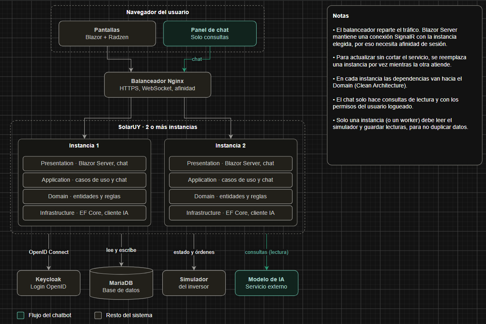
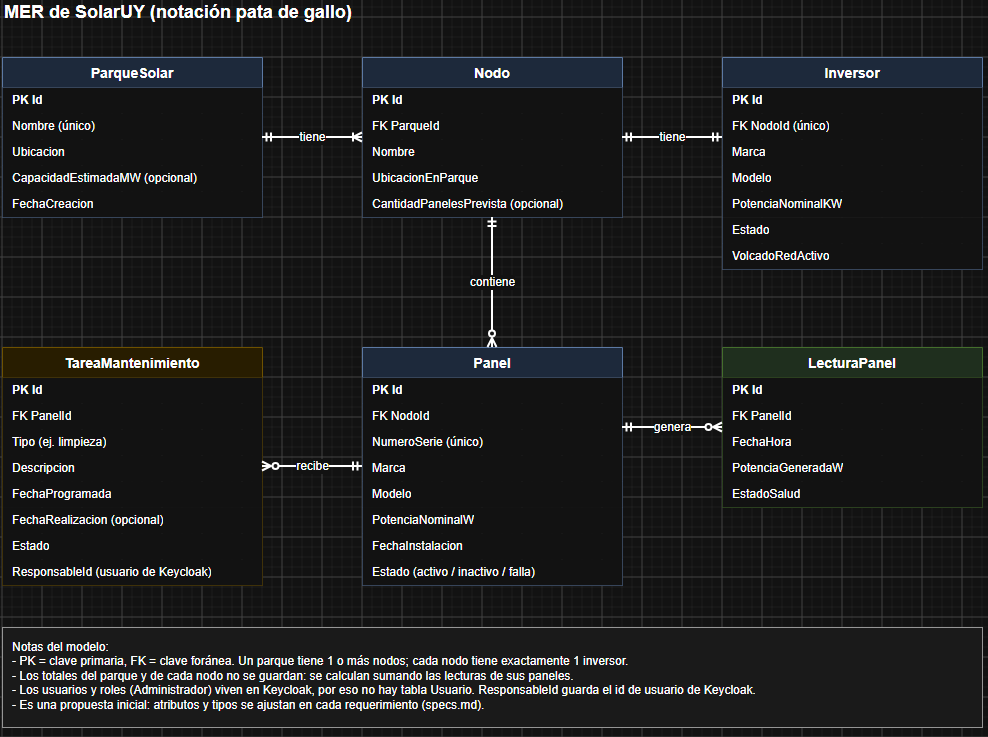

# Arquitectura y decisiones

[Inicio](../README.md) · [Configuración](Configuracion.md) · [Pruebas](Revision_Y_Guia_De_Pruebas.md)

## Diseño general

SolarUY es un monolito por capas con dos réplicas web detrás de Nginx. Cada réplica contiene los cuatro proyectos de Clean Architecture:

| Proyecto | Responsabilidad |
| --- | --- |
| `SolarUY.Domain` | Entidades y reglas de negocio. |
| `SolarUY.Application` | Casos de uso, permisos, interfaces y DTO. |
| `SolarUY.Infrastructure` | Persistencia, migraciones e integraciones con TCP, Keycloak e IA. |
| `SolarUY.Presentation` | Pantallas Blazor, autenticación, SignalR y workers. |

El diagrama representa el diseño general. Compose usa HTTP local; HTTPS requiere configuración para producción. Blazor mantiene estado por circuito: la afinidad y las claves compartidas permiten continuar autenticado, pero perder la instancia puede reiniciar el circuito y el chat. A y B compiten por un bloqueo MariaDB para que solo una adquiera y guarde cada ciclo histórico; la telemetría visual realiza lecturas separadas.

## Decisiones y tácticas principales

- **Blazor Server y Radzen:** interfaz integrada con servicios .NET y actualizaciones mediante SignalR.
- **Clean Architecture e inyección de dependencias:** separan reglas, casos de uso y detalles externos. Repositorios, DTO y adaptadores encapsulan persistencia e integraciones.
- **MariaDB, EF Core y migraciones:** persistencia relacional reproducible; transacciones e índices protegen integridad y rendimiento.
- **Keycloak/OpenID Connect:** identidad y roles externos; la aplicación comprueba permisos en los casos de uso.
- **Nginx y dos réplicas:** afinidad, WebSockets, comprobaciones de salud y reemplazo de una instancia por vez. Las dependencias compartidas siguen siendo puntos únicos de fallo.
- **Chatbot con Agent Framework/MCP:** herramientas de consulta con permisos del usuario. MCP funciona dentro del proceso; el modelo no accede directamente a la base.

Estas decisiones resumen la toma de decisiones aportada, ajustada al comportamiento implementado.

## Modelo de datos

El MER aportado es el modelo base. La implementación agrega baja lógica de paneles, procedencia histórica (`LecturaPanel.NodoId`), salud/alertas y auditoría de órdenes. Los detalles actuales están en las entidades y migraciones. Los usuarios viven en Keycloak y las fechas se guardan en UTC.

## Otras carpetas

`SolarUY.InversorSimulador` ejecuta el simulador TCP. Los proyectos `*.Tests` comprueban reglas, integración, navegador y arquitectura. `deploy/` configura Nginx/Sonar; `keycloak/`, el realm; `prompting/`, los requerimientos; `docs/`, estas guías.

Se conservan código, recursos, configuraciones y migraciones, incluidos sus archivos generados y snapshot. `bin/`, `obj/`, `node_modules/` y cobertura se regeneran. Los respaldos SQL y `artifacts/` son datos/evidencia locales; `.env` contiene secretos y no se versiona.
