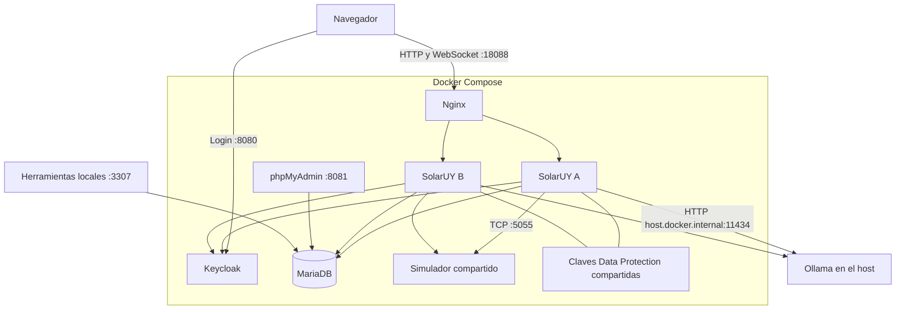
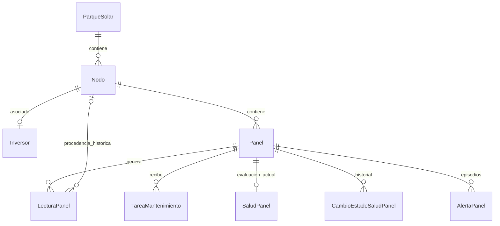
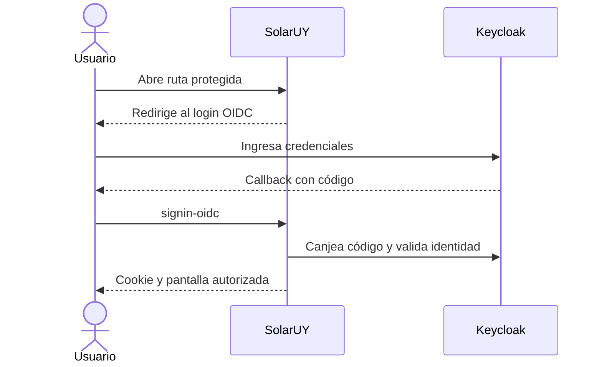
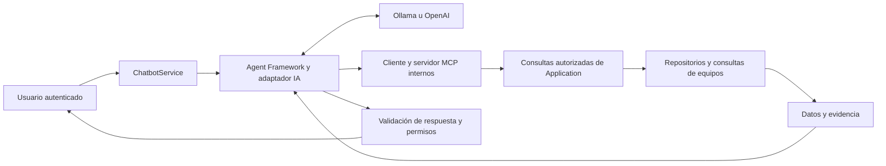

# Arquitectura de SolarUY

[Inicio](../README.md) · [Configuración](Configuracion.md) · [Arquitectura](Arquitectura.md) · [Pruebas y calidad](Revision_Y_Guia_De_Pruebas.md)

Diseño implementado, patrones, tácticas, cinco diagramas y mapa de archivos. Para instalar y arrancar, utiliza la guía de configuración.

## Arquitectura y patrones

La aplicación se organiza en capas mediante **Clean Architecture**. Cada instancia web ejecuta juntas Presentation, Application, Domain e Infrastructure. A y B son réplicas de la misma aplicación, no servicios de negocio independientes.

El diagrama muestra **dependencias de código**, no comunicaciones de red:

```mermaid
flowchart LR
    P[Presentation] --> A[Application]
    A --> D[Domain]
    I[Infrastructure] --> A
    I --> D
    P -. Composición en Program.cs .-> I
```

| Capa | Responsabilidad |
| --- | --- |
| Domain | Entidades, invariantes y comportamiento: paneles, nodos, tareas, generación y salud. No depende de EF, Blazor ni servicios externos. |
| Application | Casos de uso, autorización, contratos, DTO y validación: `PanelService`, `HistoricoGeneracionService`, `OrdenInversorService`, `ChatbotService`, entre otros. |
| Infrastructure | Repositorios, `ApplicationDbContext`, migraciones y adaptadores de MariaDB, TCP, Keycloak e IA/MCP. Implementa los contratos requeridos por Application. |
| Presentation | Componentes Blazor/Radzen, identidad, endpoints, hub y alojamiento de workers. Las pantallas invocan Application; `Program.cs` registra implementaciones. |

Patrones y decisiones observables en el código:

- **Inversión de dependencias e inyección por constructor:** los casos de uso reciben interfaces y el arranque conecta las implementaciones.
- **Repository y contexto de persistencia:** encapsulan acceso a datos; EF administra seguimiento y transacciones. Parques utiliza también `IApplicationDbContext`.
- **Servicios de aplicación, DTO y validadores:** separan coordinación, transporte de datos y validación de la interfaz.
- **Entidades con comportamiento:** operaciones como trasladar/dar de baja un panel y completar tareas protegen sus reglas en Domain.
- **Adaptadores y fábricas:** aíslan el cliente TCP y los proveedores IA. Una fábrica de contexto permite utilizar EF también desde herramientas de diseño.
- **Workers periódicos:** `BackgroundService` y temporizadores ejecutan adquisición, telemetría y salud sin depender de acciones de pantalla.
- **Notificación y observación de cambios:** SignalR actualiza clientes; observadores por instancia consultan versiones de salud en MariaDB, sin un broker externo.

## Despliegue y tácticas

Despliegue de desarrollo definido en el `compose.yaml` raíz. Las conexiones entre contenedores usan la red privada; los puertos publicados se vinculan al loopback del host.



| Objetivo | Táctica implementada y alcance |
| --- | --- |
| Disponibilidad web | Dos réplicas, reintentos del proxy y comprobaciones Docker de `/health`. Nginx detecta fallos pasivamente al comunicarse con sus upstreams; no consulta activamente ese endpoint. |
| Continuidad de acceso | Afinidad `ip_hash`, WebSockets y claves Data Protection compartidas. Ambas réplicas reconocen cookies; perder un proceso obliga a reconstruir su circuito Blazor en memoria. |
| Adquisición consistente | A/B son candidatas y compiten por `GET_LOCK` de MariaDB: un propietario por ciclo histórico. La telemetría visual realiza lecturas separadas. |
| Integridad | Transacciones, claves foráneas, índices únicos y bloqueos de nodos al reservar capacidad evitan duplicados y sobrepasar el último cupo. |
| Rendimiento | Agregación histórica en SQL e índices por panel/fecha; buffer pool InnoDB de 512 MiB en Compose. No se carga todo el histórico en memoria .NET. |
| Seguridad | OIDC, autorización en casos de uso y hub, antiforgery y secretos externos. El chatbot dispone de herramientas autorizadas de lectura, sin credenciales de MariaDB. |
| Recuperación y diagnóstico | Cancelación, tiempos límite, reintentos acotados, logs y auditoría de órdenes. Los ciclos posteriores pueden recuperarse de fallos, sin fabricar mediciones perdidas. |
| Mantenibilidad | Capas, contratos, pruebas y guardarraíles ArchUnitNET; análisis estático y cobertura en SonarQube. |

Esta redundancia cubre las webs. MariaDB, Keycloak, Nginx, simulador, Ollama y host siguen siendo dependencias compartidas sin réplicas en esta configuración. El estado operacional del simulador y la conversación del circuito se conservan en memoria, no se recuperan automáticamente tras perder sus procesos.

## Modelo de datos

Relaciones persistidas principales; Domain y las configuraciones de `Infrastructure/Persistence` contienen el detalle:



El esquema permite crear un parque antes de cargar nodos; los casos de uso protegen eliminar el último nodo. La gestión crea un inversor por nodo, con asociación única; el diagrama admite ausencia para representar también inventario legado.

Las fechas se guardan en UTC. Las lecturas conservan su nodo histórico; filas legadas sin procedencia verificable mantienen `NodoId` nulo y no se atribuyen a un parque por la ubicación actual del panel. El histórico integra potencia en energía y distingue cero medido de ausencia de datos.

La baja de paneles es lógica y conserva lecturas/mantenimiento. Se rechaza el borrado físico de nodos/parques con historial de salud. `IntentosOrdenInversor` mantiene auditoría con identificadores históricos sin claves foráneas que obliguen a eliminarla junto al inventario. Los usuarios/roles viven en Keycloak; `ResponsableId` guarda el `sub` del técnico, sin tabla local de contraseñas.

## Estructura y archivos

| Ruta | Contenido |
| --- | --- |
| `SolarUY.Domain/` | Entidades, enums, reglas de generación y salud. |
| `SolarUY.Application/` | Casos de uso agrupados por funcionalidad, contratos, DTO y validadores. |
| `SolarUY.Infrastructure/` | `Persistence`, `Migrations`, integraciones y registros de dependencias. |
| `SolarUY.Presentation/` | `Program.cs`, `Components/Pages`, componentes compartidos, layout, autenticación, workers, `wwwroot` y configuración. |
| `SolarUY.InversorSimulador/` | Arranque y Dockerfile del simulador independiente. |
| `SolarUY.Domain.Tests/`, `SolarUY.Application.Tests/` | Pruebas xUnit de reglas y servicios existentes. |
| `SolarUY.Integration.Tests/` | Integración de servicios, SQL, HTTP, TCP, concurrencia y hosts de inspección. |
| `SolarUY.Browser.Tests/` | Playwright, configuraciones y fixtures de navegador. |
| `CodeQuality.Tests/` | Restricciones de arquitectura/nomenclatura con ArchUnitNET. |
| `deploy/nginx/`, `deploy/sonar/` | Proxy y analizador. El Compose raíz integra la pila; el de Nginx permite probar webs externas. |
| `keycloak/` | Realm inicial, cliente del directorio e instrucciones específicas. |
| `prompting/` | Requerimientos y evidencia: `requirements.md`, `specs.md`, `tasks.md`, `implementations.md` y `resumen.md`. Req12 remite a req18; req20 a req8. |
| `.agents/`, `AGENTS.md` | Reglas y habilidades del repositorio; las rutas de reglas/habilidades están protegidas. |

Archivos de la raíz:

- `SolarUY.sln` agrupa proyectos y cada `.csproj` declara dependencias/compilación. `global.json` selecciona SDK y `Directory.Build.props` comparte el identificador de user-secrets.
- `compose.yaml`, Dockerfiles y Nginx permiten ejecutar el despliegue; `Iniciar-Demo.ps1` automatiza el arranque.
- `.env.example` es la plantilla compartida; `.env` guarda valores privados locales y no se versiona. `.gitignore` y `.dockerignore` excluyen secretos/artefactos.
- `Analizar-Calidad.ps1` y `coverage.runsettings` preparan análisis y cobertura.
- `solaruy_pruebas.sql` contiene datos para el restablecimiento opcional. `backup-*.sql` son respaldos históricos, no dependencias del arranque ni sustitutos de migraciones.

Conservar código, recursos web/licencias, configuraciones, pruebas y migraciones, incluidos sus `.Designer.cs` y snapshot. `bin/`, `obj/`, `node_modules/`, perfiles `.runtime/` y cobertura generada se pueden regenerar. `artifacts/` conserva resultados/capturas locales: archivar evidencia útil antes de limpiarlo. `.git/` conserva el historial del repositorio.

## Flujos principales

### Login



Los casos de uso y el hub comprueban identidad/roles además de la protección de las páginas. Ocultar botones no sustituye la autorización del servicio.

### Inventario y mediciones

1. Administrador crea parque, nodos/inversores y paneles. La capacidad del nodo es un máximo; `null` no impone límite.
2. La aplicación sincroniza inventario con el simulador. Telemetría visual consulta cada **2 segundos** y adquisición histórica guarda cada **30 segundos** con la configuración predeterminada.
3. Workers evalúan salud y publican avisos; las instancias observan cambios persistidos. Histórico y reportes consultan muestras guardadas, sin reconstruir intervalos perdidos.
4. Las órdenes requieren Administrador, confirmación y auditoría. Aceptar una orden y observar su efecto en la siguiente medición son hechos distintos.
5. Mantenimiento sigue `Pendiente → EnCurso → Completada`; tareas abiertas pueden cancelarse según permisos. Las terminales conservan su historial y son inmutables.

### Chatbot



MCP utiliza streams dentro del proceso y el ámbito autenticado; no hay que instalar un servidor MCP externo. El modelo no accede directamente a MariaDB ni ejecuta órdenes. Se distinguen consultas vacías, ausencia de datos, falta de permisos y errores de fuentes.
